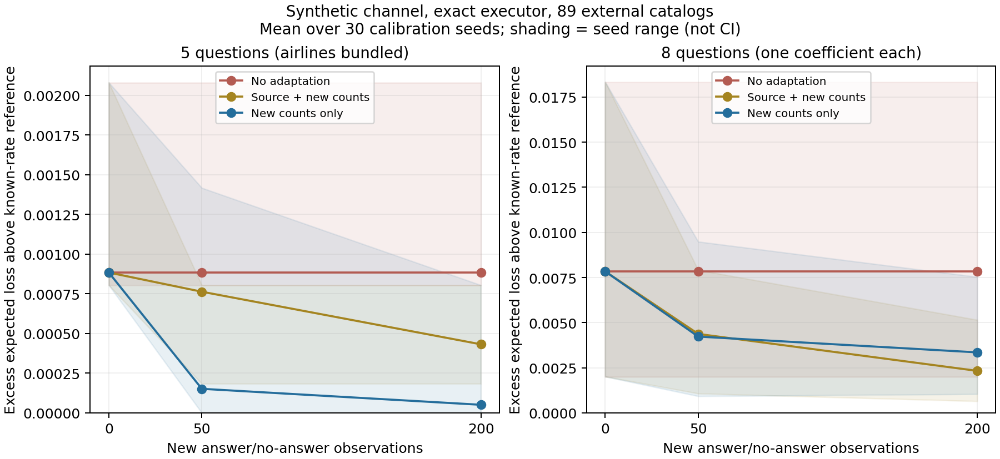

# E001a: выполненный пилот смены ответимости

## Итог и решение

Собран и запущен воспроизводимый стенд: **89 внешних каталогов рейсов, 722 профиля синтетической популяции, 3 режима ответов, 30 калибровочных seed, бюджеты 0/50/200**. Проверены два набора вопросов. Это ожидаемые значения в конечной модели, а не новые диалоги LLM. Реальные предпочтения из eval не используются.

**Сложную модель пока не обучаем.** В исходном наборе вопросов проблема почти отсутствует. При разбиении вопросов простой статистический baseline уже существенно сокращает ошибку, а остаток может объясняться неточностью оценок на малой выборке. Доказательств преимущества нейросетевой факторизации нет; прямую value head тоже ещё не проверяли.

Рабочая гипотеза получает более строгий фильтр: прежде чем инвестировать в обучение, нужен остаточный сбой при сильном простом baseline и более реалистичных ответах. Синтетические отказы, независимые от цели, сами по себе такой сбой не установили.

## Что именно сравнили

Использованы каталоги из [репозитория Dong, зафиксированный commit](https://github.com/dong-river/VOI_communication/tree/27466a7832d5aafff82017a659e08942e18b01ae). Пользователь в нашей диагностике — случайный профиль из train. Каждый метод знает одинаковое распределение таких профилей; после формального ответа выбирает рейс с максимальной ожидаемой полезностью. Ответ сообщает знак коэффициента предпочтения либо отказ. Вероятности отказа придуманы и не выдаются адаптивному методу.

Калибровка даёт только тип вопроса и бинарный факт содержательного ответа, без истинных предпочтений или награды. Новые наблюдения распределены по типам вопросов равномерно (в наборе из восьми типов — с разницей максимум один). Это адаптация к популяции на отдельных взаимодействиях, не персонализация одного человека.

Ориентир `oracle-rate EVSI` знает реальные вероятности ответа. В этом упрощении он точно оптимален среди заданных вопросов и no-ask. Он не знает намерение конкретного пользователя и не является верхней границей для произвольных LLM-агентов.

Все исходы ответов и профили суммируются точно. 30 seed меняют лишь калибровочную выборку. В каждом наборе сохранены 432 540 строк с результатами методов; это **не 432 540 независимых задач**.

## Результат в режиме selective

В этом режиме вероятность ответа на вопрос о цене падает с .9 до .2, о пересадке — до .5, о прибытии — до .8; остальные остаются .9. Таблица показывает избыточную ожидаемую потерю относительно oracle-rate, при нулевой цене вопроса. Меньше лучше; единицы — исходная награда за рейс, не проценты точности.

| Метод | Новых наблюдений | 5 вопросов, авиакомпании вместе | 8 отдельных вопросов |
|---|---:|---:|---:|
| Исходная оценка канала | 0 | 0.000884 | 0.007839 |
| Частоты только новых ответов | 50 | 0.000152 | 0.004230 |
| Частоты только новых ответов | 200 | 0.000051 | 0.003354 |
| Старые + новые наблюдения | 50 | 0.000764 | 0.004377 |
| Старые + новые наблюдения | 200 | 0.000432 | 0.002331 |
| Истинные вероятности, reference | — | 0 | 0 |

В восьмивопросном варианте 200 новых наблюдений сокращают средний разрыв примерно на 57% при использовании только новых данных и на 70% при объединении старых и новых. Проценты относятся к небольшому исходному разрыву 0.007839, а не к общей ошибке агента. Абсолютная потеря без адаптации равна 0.354562, у reference 0.346723.



На рисунке затенение — минимум/максимум по калибровочным seed, не доверительный интервал. Task-bootstrap интервалы для разрывов дополнительно сохранены в JSON; они условны на фиксированной эмпирической популяции, а не описывают неопределённость поведения реальных пользователей. Масштабы вертикальных осей панелей различаются и подписаны.

## Почему понадобился второй вариант

В первоначальном протоколе вопрос об авиакомпаниях раскрывал сразу четыре знака предпочтений при той же условной цене, что и вопросы об одном признаке. В selective его выбирает reference в 85 из 89 каталогов. Поэтому изменение ответимости остальных вопросов редко меняет решение. Это недостаток чувствительности диагностики, а не доказательство универсальной устойчивости агента.

После этого результата добавлена и отдельно помечена разведочная абляция: каждый вопрос раскрывает один коэффициент. Её результаты нельзя подавать как независимое подтверждение заранее выбранной гипотезы. Первоначальный результат сохранён. Даже отдельные вопросы всё ещё условно равноценны по нагрузке и не являются валидированными человеческими формулировками.

## Контроли и неудобные результаты

- При одинаковом снижении ответимости всех вопросов их истинное ранжирование по EVSI не меняется при нулевой цене. Адаптация не обязана помогать. Это следует также из формулы `ценность = вероятность ответа × ценность содержательного ответа` в нашем erasure-канале.
- При отсутствии сдвига отказ от 500 старых наблюдений в пользу 200 новых может ухудшать результат. В восьмивопросном варианте gap увеличился с 0.002237 до 0.003676. Дешёвая адаптация тоже может вредить из-за шума оценки.
- При uniform_drop восьмивопросная target-only адаптация увеличила gap с 0.000746 до 0.003644. Это не ошибка evaluator: появились ложные различия между типами вопросов, хотя их настоящие вероятности равны.
- При цене 0.02 все EVSI-варианты в этих условиях всё равно задают вопрос. Поэтому этот набор не проверяет содержательно границу «спросить или остановиться». Более высокую удобную цену после просмотра результата не подбирали.
- Расходы на получение калибровочных ответов не спрятаны в task loss: они указаны отдельно. Если каждый из 200 ответов стоит дополнительно 0.02, нужно окупить затраты 4. В восьмивопросном selective при среднем выигрыше pooled около 0.005508 на задачу это примерно **727 последующих задач**, при неизменной популяции и отсутствии других затрат. Это условный расчёт окупаемости, не прогноз эксплуатации.

## Что проверено в коде

Независимый двухбитный пример с аналитическими значениями, отсутствие информации, отсутствие различий между действиями, границы ценности информации, отказ при цене выше выгоды. Для всех записанных сравнений проверено, что никто не лучше точного oracle-rate при том же пуле и возможности остановки. Проверены отсутствие одинаковых каталогов в единицах оценки и SHA256 исходных файлов. После обобщения кода на восемь вопросов проверено сохранение всех 162 строк первоначального сводного результата.

Селекторам передаются только готовые оценки вероятностей, общие выгоды по prior, цена и информационный критерий. Истинные вероятности используются evaluator и явно обозначенными oracle-контролями. Эти части разделены функциями; будущий LLM-адаптер потребует отдельной проверки доступа к скрытым полям.

## Следующий шаг после этого результата

Считать E001a завершённой контролируемой диагностикой, а не всей проверкой E001. Не увеличивать число синтетических прогонов ради красивого преимущества. Для следующего уровня нужны либо реальные/LLM-ответы с частичной информацией, либо установленная на внешних данных зависимость доступности ответа от контекста. Там уже нельзя автоматически оценивать качество ответа по наличию текста.

Перед нейросетевым сравнением обязательны простой pooled/shrinkage baseline, учёт цены адаптации и сравнение с прямой оценкой полезности при одинаковой обратной связи. Любой будущий новый test должен быть отделён от изученных каталогов. Нынешний eval — development material.

## Запуск и артефакты

```bash
python3 experiments/channel_shift_pilot.py --repo /private/tmp/voi-communication-audit-20261015
python3 experiments/channel_shift_pilot.py --repo /private/tmp/voi-communication-audit-20261015 --question-set scalar
MPLCONFIGDIR=/private/tmp/flight-audit-mpl python3 experiments/plot_channel_shift_pilot.py
```

Если временной копии нет, команды получения pinned repository находятся в [аудите](EXTERNAL_BASELINE_AUDIT.md). Сам расчёт использует стандартную библиотеку, рисунок — matplotlib. Код и внешние файлы не загружают API и не вызывают LLM.

- [Код стенда](../experiments/channel_shift_pilot.py), [протокол и дополнение](E001A_PROTOCOL.md).
- [Основной сводный результат](../results/channel_shift_pilot/summary.json), [абляция](../results/channel_shift_pilot_scalar/summary.json).
- В каждой папке результатов: `per_task.csv` — подробные сравнения; `feedback.json` — воспроизводимые последовательности наблюдаемых ответов. Файлы не содержат скрытые профили пользователей из исходных данных.
