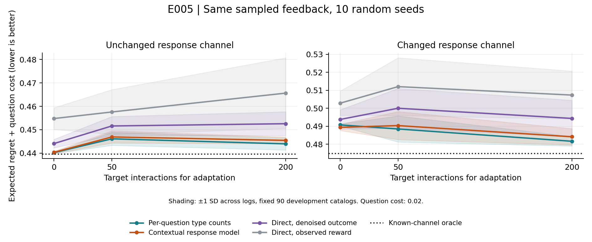

# E005: первый эксперимент с одинаковой ограниченной обратной связью

27 октября 2026. Выполнен [заранее записанный протокол](E005_PROTOCOL.md): 10 независимых журналов взаимодействий, два режима ответов, 0/50/200 дополнительных взаимодействий, три цены вопроса. Новые модели не устанавливались, API-вызовов нет.

**Главный вывод:** явная модель частот ответов обучается лучше выбранных прямых регрессий, однако ещё более простой подсчёт частот по вопросам в среднем лучше неё после адаптации. Основная гипотеза H3 о преимуществе предлагаемой факторизации над сильными конкурентами пока не подтверждена. Масштабировать нейросеть на основании этого результата не следует.

## Что теперь отличается от E002

В E002 обучающая метка была точной средней пользой вопроса, полученной полным перебором скрытых пользователей и ответов. В E005 каждому методу даётся **один и тот же журнал отдельных взаимодействий**: какой вопрос случайно выбрали, какой ответ получили, какое действие выполнил общий исполнитель и какую одну награду получил за это действие. Все исходы остальных действий и скрытый профиль текущего человека learner не получает.

Осталась сильная аналитическая привилегия: всем известно распределение возможных предпочтений и функция полезности. Из них можно вычислить, насколько полезен точный ответ или правдивая пара, а также условные ожидания после наблюдаемого ответа. Это ограниченная структурированная среда, не эксперимент с людьми или языковой моделью и не полное обучение по неизвестному окружающему миру.

Данные: 577 fit-каталогов, отдельные 72 каталога адаптации, 90 прежних development-каталогов для оценки. Prior содержит 577 записей, соответствующих 576 уникальным векторам предпочтений; дубликат сохраняет исходную частотность. Остальные 73 validation-каталога не использованы. Каталоги не пересекаются между группами. Данные проверки уже исследовались раньше, независимым финальным test они не являются.

В каждом seed: 4096 source-взаимодействий, до 200 target-взаимодействий и отдельные 4096 записей для проверки оценки по журналу. В бюджет 50/200 входят также no-ask записи, вероятность которых 1/9. Каждый диалог — новый случайный пользователь из того же prior; разные строки не являются новыми независимыми каталогами. 2160 строк сводных измерений не означают 2160 независимых экспериментальных задач.

## Сравнения

- **Simple:** частота точного/частичного/неизвестного ответа отдельно для каждого вопроса; затем аналитическая оценка выгоды. Частоты не зависят от каталога.
- **Factorized:** линейно предсказывает частоты типов ответа с учётом размаха признака каталога; затем вычисляет выгоду. Это response model + известная аналитическая полезность, без learned belief encoder.
- **Direct raw:** предсказывает выгоду по наблюдаемой награде. Вычитается известное условное ожидание награды исходного решения, а не скрытая контрфактическая награда того же пользователя.
- **Direct denoised:** те же прямые признаки, но target — условная ожидаемая выгода после наблюдаемого ответа, вычисленная из общего prior. Контроль отделяет часть выигрыша от простого уменьшения шума метки. Истинная функция в этой среде точно представима выбранными прямыми признаками.
- **Pooled:** те же методы, обученные на объединении source+target без уменьшения веса source. **Oracle:** истинный канал, только ориентир для evaluator.

При адаптации старым наблюдениям назначен номинальный вес 32 взаимодействий. У регрессий дополнительно есть ridge вокруг source-параметров, у simple — pseudocount по категориям. Это одинаковые журналы и заранее фиксированные правила, но **не доказанное равенство эффективной регуляризации, ёмкости или compute**. Гиперпараметры не подбирались по development-результатам. Эти ограничения не позволяют приписать разницу исключительно архитектуре.

## Результат при изменении ответов

В target точные ответы по некоторым вопросам становятся реже, их масса переходит в «не знаю»; частота частичных ответов сохраняется. Коэффициенты заданы в протоколе. Это искусственный канал, не измеренное поведение людей. Таблица: средний ожидаемый regret + цена .02 по 90 каталогам и 10 seed; меньше — лучше. Цена в единицах линейной полезности, не деньги.

| Метод | Без адаптации | +50 взаимодействий | +200 взаимодействий |
|---|---:|---:|---:|
| Без вопроса | 0.598205 | 0.598205 | 0.598205 |
| Случайный вопрос | 0.549572 | 0.549572 | 0.549572 |
| Выбор вопроса с расчётом на точный ответ | 0.500734 | 0.500734 | 0.500734 |
| Simple: подсчёт частот по вопросу | 0.490738 | 0.488472 | **0.481645** |
| Factorized: частоты зависят от каталога | 0.489377 | 0.490361 | 0.484141 |
| Direct denoised | 0.493769 | 0.499994 | 0.494340 |
| Direct raw | 0.502812 | 0.512014 | 0.507309 |
| Factorized pooled | 0.489377 | 0.489223 | 0.488612 |
| Oracle, истинный канал | 0.474798 | 0.474798 | 0.474798 |

При бюджете 200 разность factorized − direct denoised равна **−0.010199**, парный 95% t-интервал по seed [−0.016575; −0.003823]. Если бы сравнили только эти два метода, получился бы оптимистичный вывод. Однако factorized − simple = **+0.002496**, интервал [−0.000365; +0.005357]; factorized лучше лишь в 3 из 10 повторов. Практический порог превосходства над обоими конкурентами из протокола не выполнен.

Factorized после 200 новых взаимодействий лучше собственного pooled-варианта на .004471, но simple после адаптации ещё лучше. Это поддерживает необходимость проверять, какие старые данные сохранять при смене канала; не подтверждает новый метод факторизации. Simple сам является минимальной факторизацией известных компонентов и частот, поэтому его обязательно сохранять как сильного конкурента.

Интервалы характеризуют **только случайность журналов при фиксированных каталогах и prior**. Это не интервалы переноса на новый домен, людей или LLM; множественные сравнения в исследовательском пилоте не трактуются как подтверждающие тесты публикационной гипотезы.

## Контроль без изменения пользователей

| Метод | Source, без адаптации | +200 target | Source+target pooled |
|---|---:|---:|---:|
| Simple | **0.440182** | 0.443957 | 0.440190 |
| Factorized | 0.440331 | 0.445439 | 0.440374 |
| Direct denoised | 0.444070 | 0.452568 | 0.443845 |
| Direct raw | 0.454773 | 0.465647 | 0.454605 |
| Oracle | 0.439503 | 0.439503 | 0.439503 |

Сильное уменьшение веса старых данных при отсутствии смены канала ухудшает результат: новые 50/200 наблюдений добавляют шум. Нельзя обещать, что адаптация автоматически полезна, и нельзя выбирать между pooled и adapted, подсматривая истинные результаты target-test. Обучение правила выбора режима здесь не проводилось.



Линии — средняя потеря, области — ±1 стандартное отклонение между 10 журналами. Вертикальные шкалы двух панелей различаются; значения на осях подписаны. Пунктир — oracle. При цене .02 практически все методы спрашивают: этот режим в первую очередь проверяет выбор вопроса.

При цене .10 и shift+200 система действительно иногда отказывается от вопроса. Частота уточнений: simple .9822, factorized .9433, direct denoised .8944, oracle .9333. Потери соответственно .561542, .563809, .575386, .554267. Преимущество factorized над simple не появилось. В основной таблице **не амортизированы** затраты 50/200 взаимодействий адаптации; это отдельный бюджет и отдельный будущий анализ, не бесплатное обучение.

## Можно ли оценивать результат только по журналам

В независимом evaluation log действия выбирались равновероятно (восемь вопросов + no-ask); применены стандартные IPS и DR. Ни эти записи, ни их награды не использовались при обучении или выборе настроек.

В этом небольшом запуске оценки по наградам сильно шумят. Например, для oracle без смены канала точная чистая выгода .158702; средний IPS по 10 журналам .123461 с межseed SD .058661, DR .123774 с SD .059578. Разница входит в соответствующий t-интервал среднего, но точности для уверенного сравнения близких политик не хватает. DR здесь использует уже очень сильное предсказание; высокая вариативность отдельных наград всё равно остаётся. Следовательно, небольшое различие двух оценок IPS/DR не объявляем выигрышем политики.

Для проверки реализации после основного запуска отдельно сэмплировано по 500000 взаимодействий в двух режимах. Без shift IPS .157501 при точной истине .158702 и Monte Carlo SE .004738; с shift .128026 при истине .123407 и SE .004665. Эти записи использованы **только как численная проверка**, не для улучшения моделей или выбора гипотез. Основной результат таблиц получен точным evaluator, а не этим большим журналом.

## Что это меняет в исследовании

1. Переход от привилегированных полных меток E002 к отдельным наблюдениям теперь реализован. Фактическое уменьшение ошибки можно оценивать и обучать с наблюдаемыми исходами, но шум результата существенен.
2. В выбранном классе ответов большая часть задачи решается простыми частотами. Выигрыш над одной прямой регрессией недостаточен для нового метода.
3. Следующее содержательное действие — определить доступную внешнюю среду с проверяемым конечным исходом и проверить правдоподобие модели частичных ответов. При зависимости формы ответа от скрытого предпочтения известная семантика пары уже не даёт правильный posterior автоматически (ограничение E004). Такой режим требует явных предположений/идентифицируемости, а не механического переноса наших targets.

Полная H3 требует learned belief/текстовых представлений, одинаковой вычислительной базы, переносов и независимой агентной проверки. Они не выполнены. Эффект на придуманном канале не доказывает публикационную новизну; результаты служат решению о следующем эксперименте.

## Воспроизведение и проверки

```bash
python3 experiments/limited_feedback_pilot.py --repo /private/tmp/voi-e005-20261027
```

Проверяется pinned commit, исходные SHA256, хеши каталогов и разбиения. Сохраняются [сводка](../results/limited_feedback_pilot/summary.json), [все повторы](../results/limited_feedback_pilot/per_seed.json), [проверки](../results/limited_feedback_pilot/verification.json), веса, предсказания и хеши общих журналов. Сохраняемые веса достаточны для анализа; весь сбор журналов воспроизводится по seed и pinned source.

Проверки: нормировка каналов; границы признаков/наград; совпадение явного перебора с eV_exact+bV_partial; оптимальность общего фиксированного executor в ограниченном классе; несмещённость denoised targets; нулевая выгода «не знаю»; отсутствие hidden-state и контрфактических наград в объекте наблюдений learner. В отдельном review выполнен полный перебор малой среды: raw/denoised targets, IPS/DR и точная представимость прямыми признаками согласуются с математическими значениями до ошибок округления. Область этой проверки — данный класс каналов.

Короткий тезис: **провели первое сопоставление прямой и раздельной оценки по одинаковым отдельным взаимодействиям; простая калибровка остаётся обязательным сильным конкурентом, и оснований масштабировать предложенную архитектуру пока нет.**
