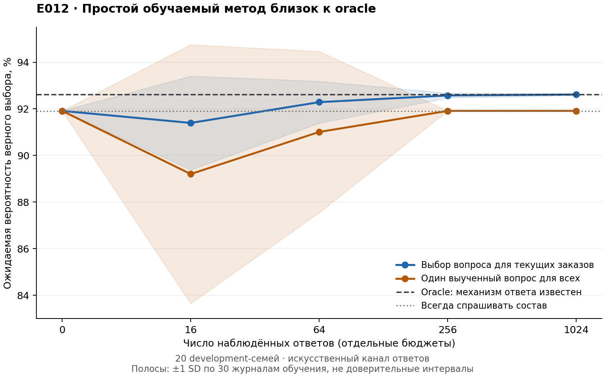

# E012: простой обучаемый оцениватель почти достигает oracle

27 октября 2026. **После 256 наблюдений простой подсчёт частот достигает 92.575% ожидаемой точности при oracle92.625%.** Средний разрыв —0.05 процентного пункта. На этой конструкции оснований усложнять модель до нейросети не появилось.

Это development-проверка на 20 ранее просмотренных семьях E011, а не итоговый закрытый тест. Частоты ответов искусственные. Новый результат — обучение частот по ограниченному журналу, в отличие от E011 с заранее известным каналом. Ни H3, ни перенос на естественный язык этим опытом не доказаны.

## Что обучалось

Для каждого вопроса считались наблюдаемые типы ответа с добавлением одного псевдонаблюдения на категорию. Номер, сумма и число позиций имеют категории answer/IDK; состав — full/partial/IDK. Получаются всего **пять свободных параметров**. Оценка использует вопрос и фактически полученный тип ответа; скрытая цель, награда и исходы незаданных вопросов ей не передаются.

Известными остаются prior, данные заказов и точный смысл каждого типа ответа. Например, программа уже знает, что partial означает случайно названное уникальное имя одного товара. Это сильная привилегия экспериментальной конструкции, а не выученное понимание языка.

30 фиксированных seed, по 1024 наблюдения; бюджеты 0/16/64/256/1024 используют вложенные части одних журналов. Обучение на 60 семьях, оценка на 20 непересекающихся семьях; прежние 20validation не использовались. Все эти семьи ранее исследованы в E011. Гиперпараметры не подбирались.

`learned_contextual` оценивает пользу каждого вопроса для текущих заказов. `learned_fixed` по тому же журналу выбирает один вопрос для всех семей, используя среднюю предсказанную полезность только на 60 обучающих семьях. Оба получают одинаковые вероятности, данные и аналитические знания.

## Результаты

Точная ожидаемая вероятность верного выбора, проценты. SD относится к 30 журналам обучения на фиксированных задачах; это не доверительный интервал и не неопределённость переноса на людей.

| Наблюдений | Выбор для текущих заказов, mean ± SD | Один выученный вопрос для всех, mean ± SD | Отставание contextual от oracle, п.п. |
|---:|---:|---:|---:|
| 0 | 91.9125 ±0 | 91.9125 ±0 | 0.7125 |
| 16 | 91.3954 ±2.0124 | 89.2025 ±5.5526 | 1.2296 |
| 64 | 92.2879 ±0.8980 | 91.0092 ±3.4591 | 0.3371 |
| 256 | 92.5750 ±0.1048 | 91.9125 ±0 | 0.0500 |
| 1024 | 92.6150 ±0.0381 | 91.9125 ±0 | 0.0100 |

Контроли на тех же 20 семьях: no-ask42.25%, всегда contents91.9125%, oracle92.625%. При цене 0.05 полезность contextual после 256 наблюдений 0.87575, oracle0.87625. Вопросы задаются во всех этих оценочных случаях. Эти числа нельзя непосредственно сравнивать с 93.63% по всем 100 семьям E011 — знаменатель другой.

Нулевая выборка уже даёт хороший выбор, хотя MAE предсказанной точности вопросов 0.1100. После 1024 наблюдений MAE снижается до 0.0110. Хорошее ранжирование вопросов здесь возможно даже при плохо откалиброванных абсолютных значениях.16 наблюдений в среднем ухудшают выбор относительно исходного prior; обучение не гарантирует монотонного улучшения в каждой малой выборке.



## Почему простой метод столь силён

Обозначим цель g, вопрос q, наблюдаемый тип k и содержание ответа y. В этой конструкции:

\[
P(k,y\mid g,x,q)=\alpha_{q,k}\,R_k(y\mid g,x,q).
\]

Частота типа \(\alpha_{q,k}\) не зависит от цели; k явно наблюдаем. Поэтому после ответа:

\[
P(g\mid x,q,k,y)=\frac{P(g\mid x)R_k(y\mid g,x,q)}{\sum_{g'}P(g'\mid x)R_k(y\mid g',x,q)}.
\]

Неизвестная частота сокращается. При известном prior и R байесовское конечное решение уже известно, и остаётся только линейная смесь:

\[
A(x,q)=\sum_k\alpha_{q,k}A_k(x,q).
\]

Для binary answer/IDK это \(eA_{answer}+(1-e)A_{IDK}\); для состава — \(fA_{full}+pA_{partial}+(1-f-p)A_{IDK}\). На всех 100 семьях проверены 400 равенств с прямым перебором E011, максимальное численное расхождение 5.6×10⁻¹⁶. Частоты можно учить без конечной награды именно потому, что условная полезность уже предоставлена аналитически.

Это применение обычного Bayes и полной вероятности, не новая теорема. Различие между фактом совместимости и механизмом наблюдения неполных данных давно изучено, в частности в [Jaeger, JAIR2005](https://arxiv.org/pdf/1109.2143). Наш вывод ограничен конкретным E011 и не устанавливает достаточность частот для произвольного языка или исполнителя.

## Что меняется без явного маркера полноты

Два равновероятных заказа: A содержит только книгу, B — книгу и лампу. Если наблюдаем именно помеченный частичный ответ «книга», вероятностьA равна 2/3 независимо от частоты partial. Если метка скрыта, слово «книга» может быть и полным спискомA, и частичным описанием любого заказа. Тогда:

\[
P(A\mid\text{«книга»})=\frac{f+p}{f+1.5p}.
\]

При(f,p)=(.45,.45) получаем.8, при(.10,.80) —.6923. Здесь механизм полноты уже влияет на posterior. **В этом примере MAP-заказ не меняется**, поэтому он доказывает различие вероятностей, а не улучшение конечного решения или новую научную гипотезу. Снимать искусственную метку стоит как проверку валидности, но нельзя заранее обещать, что это создаст преимущество нейросети. Даже без неё модель может остаться низкоразмерной и решаться простым latent-variable baseline.

## Удаление метки уже проверено

После основного опыта выполнена заранее описанная [дополнительная проверка](E012_TAG_VISIBILITY_CHECK.md): full/partial слиты в одно наблюдение с теми же названными товарами, исходные цели и joint distribution сохранены. На всех100 семьях оптимальная точность осталась прежней; падение information gain есть только у2 семей, выбор entropy и EVSI по-прежнему совпадает. Максимальная разность accuracy1.1×10⁻¹⁶ — численная погрешность. [Результат](../results/retail_small_feedback/tag_visibility.json).

Причина специальна для нашего канала: коллизия возможна только у одноэлементного полного списка. Такой заказ имеет одно уникальное имя и максимальную вероятность назвать его в partial-режиме. При равномерном prior существует общий оптимальный выбор для обеих меток, поэтому их слияние не снижает Bayes-accuracy. Удаление искусственной подсказки здесь **не создаёт зазор для нового метода**. Обучение частот без меток этим пересчётом не проверено; однако просто заявлять новый трудный decision problem после удаления тега нельзя.

## Проверки и решение

Отдельный пересчёт прочитал 30720 записей, подтвердил 150 уникальных fitted estimates для seed/budget,2700 сохранённых вероятностей с учётом двух методов, принадлежность train families и отсутствие поля скрытой цели. Методы используют одни журналы. Сохранены исходные наблюдения, per-seed результаты, вероятности и хеши.

**Текущую линию «сложная модель вместо частот на E011» закрываем как исследовательскую ставку.** Код остаётся сильным baseline и проверкой установки. Не создаём новый выгодный канал задним числом. Следующий дизайн должен обосновать неизвестный механизм содержания/полноты ответа на исходных сценариях и проверить сильную простую альтернативу. [Разбор границы знания пользователя](RETAIL_KNOWLEDGE_BOUNDARY.md) даёт 34 привязанных к источнику наблюдения, но не эмпирические частоты.

## Артефакты

[Протокол](E012_PROTOCOL.md), [сводка](../results/retail_small_feedback/summary.json), [per-seed результаты](../results/retail_small_feedback/results.json), [верификация](../results/retail_small_feedback/verification.json), [код](../experiments/retail_small_feedback.py).

```bash
python3 experiments/retail_small_feedback.py --repo /private/tmp/tau3-audit-20261027
python3 experiments/verify_retail_small_feedback.py
```

Для первой команды нужен тот же Python/Pydantic runtime, что в E011; установки зависимостей не было. Новых модельных вызовов, языкового обучения и полного agent benchmark нет. Публикационная цель остаётся открытой.
