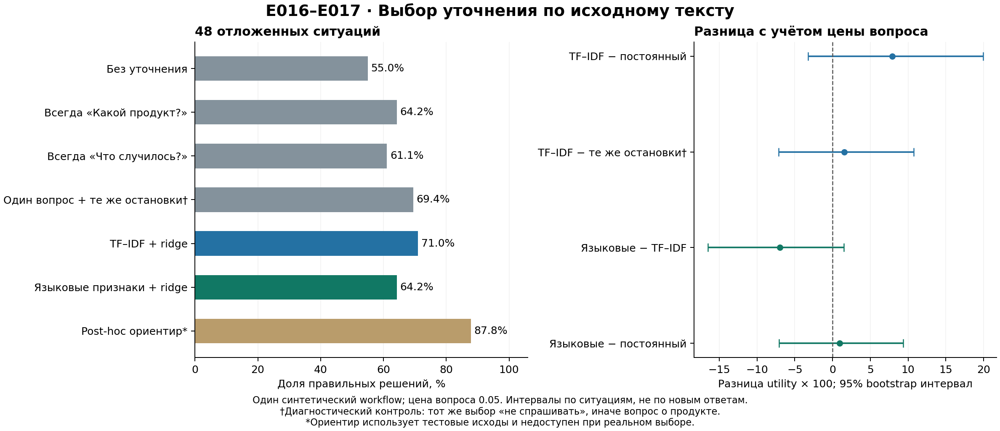

# E016–E017: обучаемый выбор уточнений на отложенных ситуациях

27 октября 2026. **Завершено и независимо проверено.**

Получен положительный, пока неопределённый сигнал: TF–IDF + ridge дал71.0% точности против64.2% у лучшего постоянного вопроса, задавая вопросы в77.1% ситуаций. Однако контроль с теми же остановками достигает69.4%. Таким образом, преимущество выбора *какого* вопроса задать значительно меньше общего выигрыша; публикационный вклад и основная гипотеза об учёте неполных ответов пока не установлены.

## Что именно проверено

96 обучающих и48 отложенных компонент из внешнего синтетического Lavoir banking_support. Все24 прежние development case E014 исключены вместе с совпадающими нормализованными текстами. Между train/test нет одинаковых начальных текстов и полных prompts. Всего402 скрытых профиля; в test128. Каждая компонента имеет одинаковый вес, профили внутри неё усредняются. Поэтому проценты ниже — взвешенная точность, а не доля людей или число верных ответов из48.

Для каждого профиля проверены шесть ветвей: без вопроса и пять опубликованных вопросов с ответами. Получено1324 уникальных генерации —886 train и438 test; они обслуживают2412 profile–branch записей. Одна локальная Qwen3-4B-Instruct-2507-4bit, закреплённая версия, greedy decoding. Это одна внешняя routing-задача, **не полный многошаговый агентный benchmark**.

Первый selector использует TF–IDF и ridge(alpha1). Второй — фиксированные признаки той же языковой модели и такой же ridge; веса языковой модели не обучались. Оба видят только исходный текст, без скрытой цели, будущего ответа и аннотаций. Все48 решений каждого selector сохранены и проверены **до первой test generation**. [Протокол E016](E016_PROTOCOL.md), [протокол E017](E017_PROTOCOL.md), [свидетельство последовательности запуска](../results/encoder_value_e017/test_start_witness.json).

## Основная оценка

Цена вопроса0.05; utility = точность −0.05×доля вопросов.

| Метод | Точность, % | Utility | Доля ситуаций с вопросом, % |
|---|---:|---:|---:|
| Без уточнения | 55.03 | 0.55035 | 0 |
| Равномерно случайный вопрос | 59.03 | 0.54028 | 100 |
| Всегда issue («Что случилось?») | 61.11 | 0.56111 | 100 |
| **Всегда product; выбран по train** | **64.24** | **0.59236** | **100** |
| Всегда money_gone | 61.11 | 0.56111 | 100 |
| Всегда compensation | 55.73 | 0.50729 | 100 |
| Всегда customer_name | 52.95 | 0.47951 | 100 |
| **TF–IDF + ridge, E016** | **71.01** | **0.67153** | **77.08** |
| Языковые признаки + ridge, E017 | 64.24 | 0.60174 | 81.25 |
| Post-hoc oracle по видимой компоненте | 87.85 | 0.85556 | 45.83 |

Последняя строка использует реальные тестовые исходы всех ветвей, поэтому недоступна обычному агенту. Это не обученный метод и не гарантированно достижимое качество на новых ответах.

Ridge выбирает product25 раз, no_ask11, money_gone8, issue4. Encoder выбирает product34, no_ask9, issue4, money_gone1. MAE прогнозов шести branch accuracies: ridge0.32707, training mean0.36684, encoder0.36846. Дополнительные языковые признаки в этой фиксированной конфигурации не улучшили оценку. Это не доказательство бесполезности всех encoder-моделей или других настроек.

### Неопределённость

Парный bootstrap по48 компонентам,10000 повторов. Интервалы описательные, без заявлений о статистически доказанном общем превосходстве и без поправки на весь последовательный исследовательский поиск.

| Разность utility | Оценка | 95% интервал |
|---|---:|---:|
| Ridge − training-chosen product | +0.07917 | [−0.03229; +0.19931] |
| Ridge − fixed issue | +0.11042 | [+0.00139; +0.22222] |
| Encoder − ridge | −0.06979 | [−0.16493; +0.01494] |
| Encoder − training-chosen product | +0.00938 | [−0.07083; +0.09375] |
| Encoder − fixed issue | +0.04063 | [−0.09097; +0.17292] |

Главное сравнение с сильным постоянным product **допускает отсутствие выигрыша**. Нельзя выбрать более слабый issue только ради положительной нижней границы. Для ridge против product:14 компонент улучшились по utility,5 ухудшились,29 совпали. Интервалы не учитывают вариативность новых пользовательских ответов и других исполнителей.

## Выбирать вопрос или вовремя остановиться?

Дополнительный контроль объявлен и сохранён во время test inference, до просмотра агрегированных исходов. Он **диагностический**, а не часть исходного списка подтверждающих сравнений. В нём сохраняем те же решения «не спрашивать», а во всех остальных случаях задаём training-chosen product. Число вопросов точно совпадает с полным selector. [Замороженные решения](../results/e016_e017_stopping_control/policies.json), [статус и хеши](../results/e016_e017_stopping_control/manifest.json).

| Политика | Точность, % | Utility | Доля вопросов, % |
|---|---:|---:|---:|
| Product всегда | 64.24 | 0.59236 | 100 |
| Product с остановками ridge | 69.44 | 0.65590 | 77.08 |
| Полный ridge | 71.01 | 0.67153 | 77.08 |
| Ridge, принудительно всегда задающий лучший предсказанный вопрос | 66.15 | 0.61146 | 100 |

Разность полного ridge и product с теми же остановками — **+1.5625 процентного пункта точности**; utility меняется на столько же, поскольку число вопросов одинаково. Описательный95% интервал utility [−0.07118; +0.10768];4 компоненты лучше,4 хуже,40 одинаковы. Контроль остановки воспроизводит около80% общей разницы utility против постоянного product:0.06354 из0.07917. Это арифметическое разложение относительно данного контроля, не универсальная причинная доля механизма.

Для encoder контроль с теми же остановками даёт63.72% против64.24% полного метода; разница выбора вопроса лишь0.52 п.п. [Все результаты контроля](../results/e016_e017_stopping_control/summary.json).

**Вывод:** на данном наборе обучение лучше демонстрирует полезность решения «не задавать лишний вопрос», чем преимущества сложного выбора между вопросами. Сравнение с постоянным вопросом без одинакового stop-gate преувеличивает доказательства именно для question selection.

## Неполные ответы и ошибки исполнителя

В640 test probes источника:549 clean,37 partial,26 unknown,28 extra. Это наблюдённый состав выбранного набора, а не человеческие частоты и не номинальные параметры генератора.

Среди реально выбранных ridge ветвей:11 partial-ответов и3 unknown-ответа, остальные —78 clean,9 extra и27 profile records без вопроса. При наших весах partial занимают9.03% общей массы, unknown2.43%. Относительно **сопоставимого no-question по тому же профилю** вклад в прирост точности: clean+12.50 п.п., extra+1.39, partial+2.08, unknown0. Сумма+15.97 п.п. Это разбор реализованных ответов; он не измеряет причинное преимущество partial над clean и не доказывает выигрыш от обучения механизма неполного ответа.

Из общего прироста ridge против no-question,13.89 п.п. приходятся на ветви с изменившимся символическим posterior отдела и2.08 п.п. — на неизменившийся posterior. Последняя часть согласуется с исправлением ошибок исполнения; это не новая информация о цели. Символический posterior использует аннотации и исходный prior источника, недоступные selector. Он служит диагностике и не объявляется Bayes ceiling нашего эмпирического распределения.

На train отдельно разобраны9 ошибок no-question при формально достаточных исходных фактах:7 текстов поддерживают ошибку применения правила,2 имеют смысловую неоднозначность. [Разбор с примерами](E016_TRAINING_ERROR_REVIEW.md). Выборка по этим наблюдениям не редактировалась.

## Перенос и воспроизводимость

В train51 различный паттерн известных решающих фактов, в test31. Двенадцать общих паттернов покрывают29 из48 test-компонент. Поэтому точные тексты разделены, но новые семантические типы задач специально не удерживались. [Аудит до test](../results/e016_split_structure/summary.json). На19 компонентах с новыми паттернами ridge получил81.14%, на29 с встречавшимися —64.37%; это небольшие неодинаковые по сложности подгруппы, не доказательство превосходства на OOD. Основная оценка использует все48 случаев.

Все1324 генерации завершились; повторных запусков плохих ответов нет. Неверный формат получили2 train outputs и1 test output; все оценены нулём по протоколу. В test модель задала новый вопрос вместо выбора team: ветвь compensation вcase00381, не выбранная ни одним издвух selectors. Данные не «починены». Runtime errors и усечённых outputs нет. Train inference занял1608.50с, test818.10с, извлечение144 языковых векторов55.69с; суммарно около41.4мин вычислений этих этапов. Дополнительный encoder обработал11754 input tokens без декодирования, peak memory2.63GB; executor peak2.82GB. [Учёт запусков](../results/e016_e017_diagnostics/run_accounting.json). Это локальный запуск без платного API.

Независимые проверки восстановили все source/split joins,576 training targets, оба набора48 predictions, сохранённые model arrays, выбранные действия, точные веса метрик и bootstrap. SVD-прогнозы отличаются от исходного dual solve не больше4.45×10⁻¹⁵. [E016 verification](../results/heldout_value_e016/verification.json), [E017 verification](../results/encoder_value_e017/verification.json). Анализ типов ответов использует рациональные веса и точное сравнение символических posterior; вклады сходятся с основными scores. [Диагностика](../results/e016_e017_diagnostics/summary.json).

## Решение после опыта

Сохранить TF–IDF + ridge как рабочий baseline; **не объявлять его новым методом**. В будущих сравнениях обязательно включать постоянный вопрос с тем же stop-gate. Не усложнять модель только ради победы над fixed-always-ask.

Следующая содержательная проверка — устойчивость ценности вопросов к ошибкам исполнителя: отдельно проверить применение правил по уже достаточным фактам, затем сравнить вопросные политики при более надёжном исполнении и на новых компонентах. E016 test после этого разбора становится development evidence для новых решений; повторно объявлять его нетронутым нельзя. Параллельно необходима узкая заявка, отличимая от [REVOIR и AFA/AFAPE](LITERATURE_FOLLOWUP_E016.md), CLEAT и Model-Free PE. Текущие результаты — проверенный исследовательский шаг, не готовая статья для ведущего журнала.

Последующий [контроль E018](E018_RESULTS.md) уже завершён: нейтральные коды отделов исправили 3 из 7 ясных ошибок при заранее заданном минимуме 4. Перебор названий не продолжается; следующий шаг — раздельная проверка извлечения фактов и применения правил.

### Как проверить сохранённый результат

Из корня проекта, в окружении с numpy, запустить `experiments/verify_heldout_e016.py`, затем `experiments/verify_encoder_e017.py`. Они не выполняют генераций и проверяют сохранённые артефакты. Скрипты inference намеренно отказываются перезаписывать уже начатый запуск; новый replay требует отдельного каталога и явно описанного нового run. Полное описание метода: [рабочий methods draft](METHODS_WORKING_DRAFT.md).
