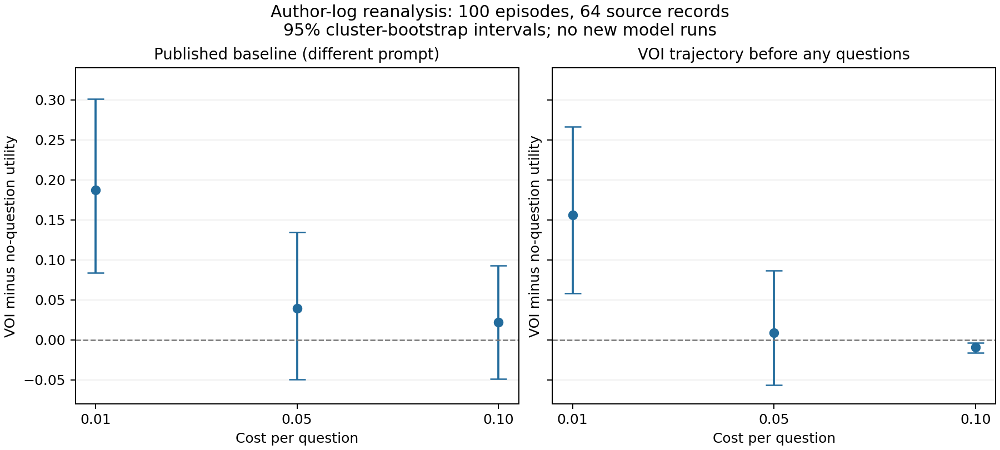

# Внешний baseline: первый выполненный запуск и аудит

15 октября 2026, Asia/Dubai.

## Что выполнено

Скачан [публичный репозиторий Dong](https://github.com/dong-river/VOI_communication) в отдельный временный каталог. Зафиксирован commit `27466a7832d5aafff82017a659e08942e18b01ae`. Изучены flight_rec/evaluate.py, runner, сборка prompts и релевантные части VOI. Запущен оригинальный offline evaluator на сохранённых авторских траекториях; независимо пересчитаны все 24 строки средней награды, числа вопросов и utility. Совпадение проверяется assert с допуском 1e-10.

**Это воспроизведение расчёта по авторским логам, не повторная генерация ответов LLM и не эксперимент со сменой пользователей.** Метка модели в файлах — `openai/gpt-5.4`; происхождение ответов независимо не удостоверялось. Ни одна новая модель не обучалась.

## Первый результат

Utility здесь — награда за выбранный рейс минус цена вопросов; больше лучше. Ниже наши вычисления из логов.

| Цена вопроса | VOI utility | NoQuestion из авторской таблицы | VOI до любого уточнения | VOI минус собственный старт, 95% интервал |
|---|---:|---:|---:|---|
| 0.01 | 0.40945 | 0.22210 | 0.25305 | +0.15640 [0.05824; 0.26660] |
| 0.05 | 0.26160 | 0.22210 | 0.25305 | +0.00855 [−0.05668; 0.08679] |
| 0.10 | 0.24405 | 0.22210 | 0.25305 | −0.00900 [−0.01616; −0.00348] |

Почему два варианта «без вопросов»: авторский скрипт запускает VOI с `cot`, а остальные методы — с `belief_dist`. Значит, в исходном сравнении меняется ещё и prompt исполнителя. Контроль по нулевому ходу собственного VOI сохраняет стартовый prompt. Он не делает весь анализ причинным, но помогает отделить исходное различие агентов от пользы последующих уточнений.

При цене 0.10 вопросы заданы в 8 эпизодах, всего 9 вопросов. Во всех восьми конечная награда совпадает с наградой нулевого хода. Поэтому снижение utility здесь целиком объясняется затратами. Это наблюдение именно об этих траекториях; оно не доказывает, что математическое ожидание пользы вопросов равно нулю, и не опровергает статью в целом.

При цене 0.01 положительный результат сохраняется и относительно собственного старта. При 0.05 данных недостаточно для уверенного вывода по этому сравнению. Мы не выбирали «лучшую цену» как новую настройку метода; все три значения взяты из внешнего evaluator. Интервалы разведочные, без поправки на множественные сравнения.



## Данные и единица анализа

В eval.json — 90 записей, из которых 89 имеют минимум шесть раундов для пяти примеров истории и одного нового выбора. Авторские 100 эпизодов выбирают исходные записи с повторениями. Восстановлено 64 разных source records по seed 8 и стандартным настройкам; рассчитанные из исходных данных награды совпали с логами обеих стратегий.

Интервалы: парный percentile cluster bootstrap, 4000 повторений, seed 20261015; кластер — исходная запись, все её эпизоды переносятся вместе. Оценивается среднее по эпизодам. Это учитывает найденные повторы, но не гарантирует независимость разных записей: общие реальные пользователи/профили отдельно не восстановлены. Интервалы условны на имеющихся ответах модели, не включают вариативность новых запусков.

В train.json — 722 записи, но только 54 удовлетворяют требованию минимум шесть раундов. Полных совпадений записей между train/eval не найдено; это не проверка отсутствия общих пользователей. Наивный план обучаться на сотнях независимых полных историй из этого train не обеспечен данными.

## Проверки качества

- Все 200 файлов прочитаны. У baseline 100 траекторий по четыре состояния; у VOI 72 по четыре, 17 по три, 9 по два, 2 по одному. В коротких VOI-траекториях отсутствует следующий вопрос; их нельзя дополнять вымышленными ответами.
- Награды проверены по ground_truth_scores и дополнительно по скалярному произведению исходных признаков рейса и reward_function.
- В `voi/0087.jsonl`, turn 1, вспомогательные поля противоречат выбранному действию: stored regret=1.23 вместо 0, correctness=false вместо true. Награда согласована с исходными данными. Авторская utility-таблица не зависит от этих двух полей и не меняется. В нашей accuracy использован пересчёт; оригинальные файлы не правились.
- После вопросов награда иногда уменьшается: 22 из 259 переходов VOI, 24 из 300 baseline. Это описательные связанные наблюдения, не независимые испытания и не доказательство вредности конкретных вопросов. Альтернативные незаданные вопросы в логах не наблюдаются.
- Подозрение на случайные предпочтения в support history для стандартного запуска снято: `simulate_errors` — флаг store_true, по умолчанию false. Включение этого флага в некоторых builders действительно подставляет случайный выбор как пользовательское предпочтение; в нашем протоколе его не использовать. Нельзя утверждать, что он испортил сохранённые результаты.

## Доступность и ограничения запуска

Offline evaluator использует стандартную библиотеку Python и успешно выполнен. Локальный Python — 3.9; в VOI-коде есть аннотации вида `T | None`, поэтому для полноценного запуска нужен совместимый Python (проверить 3.10+). В проверенном окружении отсутствуют openai и requests; OPENAI_API_KEY и OPENROUTER_API_KEY не заданы. Значения секретов не читались в вывод. Новые LLM-траектории не запускались.

Лицензионный файл в скачанном дереве не найден. Репозиторий изучен локально; сторонний код и данные не включены в наш репозиторий. Перед распространением производного датасета нужно установить условия использования и первичное происхождение данных. Это не мешало анализу уже доступных файлов.

## Решение для проекта

Среда пригодна для диагностики конечного решения: награда вычисляется явно. Но сохранённые логи не позволяют честно подменить ответ на «не знаю» и узнать дальнейшее поведение агента. Поэтому E001 не считается выполненным.

Следующий онлайн-пилот должен фиксировать один prompt исполнителя для всех селекторов, источник каждой задачи, один и тот же пул вопросов и реальную стоимость вызовов. Нужны отдельные ответы исполнителя после обычного ответа и после отказа. Сначала небольшая development-выборка уникальных задач; нынешний eval уже исследован и не является нетронутым финальным тестом. Прямая модель/факторизация пока не обучаются.

Основной вывод для гипотезы: обнаружена причина ужесточить контроль сравнения. Новизна адаптации к смене поведения пользователей по-прежнему не доказана. Аудит не заменяет проверку этой гипотезы.

## Воспроизводимость

Команды из корня нашего проекта (скачивание требует сети; новых API-вызовов нет):

```bash
git clone https://github.com/dong-river/VOI_communication.git /private/tmp/voi-communication-replay
git -C /private/tmp/voi-communication-replay checkout 27466a7832d5aafff82017a659e08942e18b01ae
python3 experiments/audit_flight_logs.py --repo /private/tmp/voi-communication-replay
python3 experiments/plot_flight_audit.py
```

Построение рисунка дополнительно требует matplotlib. Расчёт таблиц от него не зависит. SHA256 входных файлов, версия Python, параметры bootstrap, несогласованные поля и результаты сохранены в [audit.json](../results/flight_audit/audit.json). Оригинальный stdout — [upstream_table.txt](../results/flight_audit/upstream_table.txt). Код проверки — [audit_flight_logs.py](../experiments/audit_flight_logs.py).
