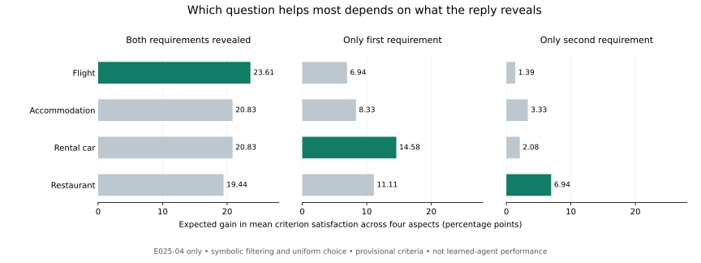

# E026: неполный ответ может изменить полезный вопрос — в диагностическом расчёте

8 ноября 2026. На тех же 12 development-задачах UserBench построены явные критерии предпочтений и выполнены 192 расчёта с разным объёмом раскрытой информации. **В двух задачах лучший вопрос меняется, если вместо обоих предпочтений раскрыть только первое.** При раскрытии только второго — в одной задаче. Это результат символического фильтра с равновероятным выбором оставшегося варианта, с предварительной интерпретацией предпочтений. Обученного агента и оценённых вероятностей пользовательских ответов пока нет.

## Что означает результат на примере

В задаче E025-04 нужно выбрать перелёт, жильё, машину и ресторан. Разрешён один вопрос — про одну из этих четырёх частей поездки.

- Если пользователь рассказывает оба требования к перелёту, вопрос о перелёте полезнее остальных.
- Если он сообщает только первое требование по выбранной части поездки, полезнее вопрос о машине.
- Если он сообщает только второе, полезнее вопрос о ресторане.

Вопрос о машине раскрывает пожелание economy и возможность дополнительного водителя. Для перелёта важны пересадка в Hong Kong и питание. По полному ответу можно отсеять больше неподходящих рейсов; при ответе только о городе пересадки остаётся несколько вариантов, из которых не все дают нужное питание. Для машины уже первое пожелание сильно сужает выбор.

| О чём спросить | Раскрыты оба требования | Только первое | Только второе |
|---|---:|---:|---:|
| Перелёт | **23,61** | 6,94 | 1,39 |
| Жильё | 20,83 | 8,33 | 3,33 |
| Машина | 20,83 | **14,58** | 2,08 |
| Ресторан | 19,44 | 11,11 | **6,94** |

Числа — прирост ожидаемой доли решений, удовлетворяющих **двум нашим критериям**, усреднённой по четырём частям поездки, в процентных пунктах. Ожидание здесь берётся по случайному выбору исполнителя. Это не вероятность успешной поездки, не выигрыш обученной модели и не ожидание по реальным ответам людей. Все четыре вопроса имеют одинаковый бюджет; цена вопроса не оценивалась.

## Как считали

[Протокол](E026_PROTOCOL.md) зафиксирован до подсчётов. Для всех 96 предпочтений составлен [каталог правил](../results/userbench_semantics_e026/criteria.json), затем закреплён его хеш — до применения к вариантам. 85 правил удалось операционализировать через поля данных; 7 оставлены неоднозначными, 4 — не проверяемыми по имеющимся сведениям.

«Операционализировать» означает принять явную проверяемую договорённость: например, искать Wi-Fi в полном списке услуг. Это не независимое доказательство того, что правило полностью передаёт намерение человека. Цена уборки не сообщает её частоту; число сидений не гарантирует удобство; «разумная пересадка» без численной границы не превращена произвольно в порог.

Для каждого из 864 вариантов вычислены T/F/U: выполняет критерий, противоречит ему или данных недостаточно. U не считается ошибкой пользователя и не совпадает с ответом «не знаю». Это неопределённость нашей оценки.

До уточнения исполнитель выбирает равновероятно среди 18 вариантов. После раскрытия условия исключает лишь варианты, явно ему противоречащие, и снова выбирает равновероятно. Рассмотрены четыре фиксированных вопроса — о перелёте, жилье, машине и ресторане — без подсказки об активных скрытых предпочтениях. Ответы заданы четырьмя масками: оба условия, первое, второе, никакой информации. Порядок «первое/второе» взят из файла авторов и не является моделью поведения людей.

При U рассчитаны нижняя и верхняя границы возможного выигрыша, с одним и тем же неизвестным исходом до и после вопроса. Это границы при недостающих данных, не доверительные интервалы. Вопрос назван однозначно лучшим, только если его нижняя граница выше верхних границ всех остальных. Пересекающиеся интервалы и равенства сохранены. [Точное определение](E026_METHOD.md).

## Что показали проверки

- Полный ответ → только первое условие: смена лучшего вопроса в E025-04 и E025-05, то есть 2/12 задач.
- Полный ответ → только второе: смена в E025-04, то есть 1/12.
- В полном режиме уникальный лучший вопрос установлен только для 5/12 задач; в остальных сохранились равенства или перекрывающиеся границы.
- **Оба случая смены имеют общий шаблон flight:2-26.** Считать их двумя независимыми подтверждениями нельзя. Выборка знакомая, контрольного теста здесь нет.

Нашлось ещё одно конкретное расхождение исходного эталона с текстом: в E025-04 пользователь указывает Hong Kong, но source-best F12 летит через Los Angeles. В E025-05 среди source-correct есть пересадки через Tokyo и Dubai вместо явно названного Bangkok. Эти наблюдения сохранены рядом с исходными метками; метки авторов не переписаны.

Проверка обнаружила и **нашу ошибку**: буквальное сопоставление Zillow Rental не принимало Zillow Rentals. Оно ошибочно отвергло три квартиры. Первичный прогон сохранён; отдельный [анализ исправления](../results/userbench_semantics_e026/review_summary.json) разрешает ровно эти две формы имени. Три итоговых статуса стали U вместо F, потому что частота уборки всё ещё неизвестна. Два случая пустого набора кандидатов исчезли. Список смен лучших вопросов не изменился.

После этой отдельно указанной поправки из 144 source-correct вариантов: 105 проходят оба операционных критерия, 6 противоречат хотя бы одному, 33 остаются неопределёнными. Из 48 source-best: 34/3/11 соответственно. Это согласованность с **нашей предварительной системой правил**, а не установленная частота ошибок всего benchmark.

## Что готово в коде

[Правила](../experiments/semantics_e026.py), [расчёт](../experiments/run_semantics_e026.py), [независимый пересчёт](../experiments/verify_semantics_e026.py), [поправка имени отдельным прогоном](../experiments/review_semantics_e026.py), [12 тестов](../experiments/test_semantics_e026.py), [все результаты](../results/userbench_semantics_e026/), [инструкция](../REPRODUCE.md).

12 тестов прошли. Независимый арифметический проверяющий код подтвердил все 192 расчёта точными дробями, перебрав все возможные количества успешных U-вариантов; проверены 488 таких сочетаний в первичном прогоне. Тест общей формулы границ перебирает все бинарные заполнения для всех 81 четырёхэлементных наборов T/F/U. Проверяющий код не валидирует человеческий смысл разметки — семантику пока разбирал один ассистент. График визуально проверен.

Модельных вызовов: 0. Официальный test и банковский резерв не оценивались. E025 и более ранние результаты не изменены.

## Что это меняет в проекте

Теперь есть воспроизводимый пример самого механизма, который нас интересует: выбор вопроса зависит от содержания получаемого ответа. Он даёт материал для следующего прототипа, но пока недостаточен для утверждения о новом методе или преимуществе обученной системы.

Следующий этап — проверить, сохраняется ли этот механизм у исполнителя, который использует видимые признаки и тексты, и отделить эффект от слабости случайного baseline. До обучения выбора вопросов нужно задать доступное агенту распределение целей/ответов, контролировать повторяющиеся шаблоны и проверить семантику независимо. Оценка предпочтений здесь не включает всю реализуемость поездки или стоимость; эти ограничения должны оставаться отдельными.
