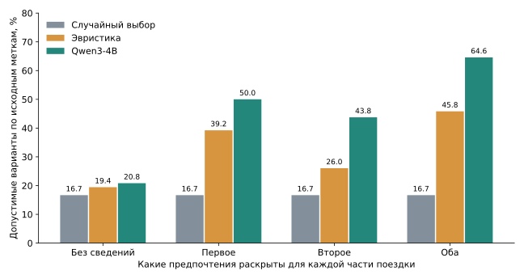
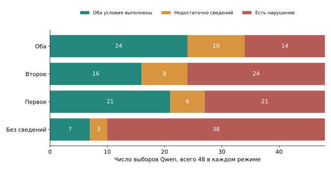
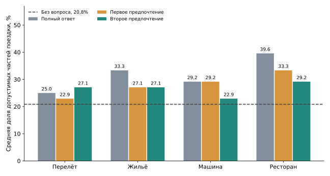
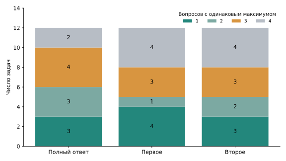

# что сейчас есть по проекту

9 ноября 2026

собрала здесь постановку, результаты и вопросы, с которыми хотелось бы свериться. по исходному плану я отстаю. основной эксперимент с раздельной моделью цели и ответа пока впереди. сейчас готовы небольшие пилоты, анализ UserBench и проверка того, как Qwen использует раскрытые предпочтения.

## 1. какой вопрос я пытаюсь проверить

исходная тема сохраняется — выбирать уточнение по ожидаемому улучшению конечного решения, учитывая, что пользователь может ответить частично, неоднозначно или «не знаю».

основная гипотеза из плана — отдельно моделировать цель пользователя и возможный ответ на вопрос полезнее при смене условий общения, чем сразу предсказывать пользу вопроса. для её проверки нужны одинаковые данные, число вопросов и модель, которая принимает итоговое решение. сравнения должны включать прямую оценку пользы, порог неопределённости, information gain и простой Bayesian EVSI.

в последних экспериментах я дошла до проверки данных и конечного выбора после ответа. сравнение обучаемой факторизации с прямой оценкой ещё не проведено.

## 2. что было до текущего пилота

| Этап | Что проверяли | Что получилось и что из этого следует |
|---|---|---|
| Первые обученные оценщики, E016–E017 | Выбор вопроса на синтетических задачах | На 48 ранее отложенных ситуациях оценщик получил 71,01%, постоянный вопрос с теми же решениями «не спрашивать» — 69,44%. Оставшаяся разница около 1,6 п.п. неопределённа. Эти данные уже просмотрены и дальше считаются данными разработки |
| Проверка на другом диагностическом наборе, E023 | Меняется ли полезный вопрос при неполных ответах | Разрыв 0,52 п.п. в 1 из 96 групп. Заранее заданный критерий продолжения — 1 п.п. и 8 групп — не достигнут. Резерв из 217 групп не оценивался |
| Проверка UserBench, E025 | Подходят ли задачи и исходные метки | Выделен фиксированный срез из 12 train-задач. Найдены повторы шаблонов, спорные эталоны и отсутствующие варианты в списках ID |
| Символический исполнитель, E026 | Может ли полнота ответа менять лучший вопрос при точном применении правил | Для первого предпочтения эффект найден в 2/12 задач, для второго — в 1/12. Два случая используют один шаблон перелёта |
| Qwen и простые сравнения, E027 | Сохраняется ли эффект у модели, использующей текст и видимые варианты | Дополнительные сведения улучшают выбор. Строгой смены единственного лучшего вопроса по предварительным семантическим правилам у Qwen пока нет |

эти этапы относятся к разным постановкам. их проценты нельзя объединять в одну кривую прогресса.

[Первые оценщики](../research/E016_E017_RESULTS.md) · [E023](../research/E023_RESULTS.md) · [Проверка данных](../research/REPORT_2026-11-08_E025.md) · [Символический эксперимент](../research/REPORT_2026-11-08_E026.md)

## 3. какие данные использованы сейчас

в UserBench пользователь планирует поездку. нужно выбрать перелёт, жильё, машину и ресторан. у каждой части поездки есть два скрытых предпочтения и меню из 18 вариантов.

| Что считаем | Количество |
|---|---:|
| Задачи в текущем срезе | 12 |
| Отдельные выборы внутри задач | 48 |
| Предпочтения | 96 |
| Варианты в меню | 864 |
| Варианты, допустимые по исходной разметке | 144 |
| Единственные лучшие варианты по исходной разметке | 48 |

12 задач выбраны из 96 train-задач по заранее заданному хешу. задачи синтетические, созданы авторами UserBench. официальный test не оценивался. вариант внутри меню — зависимое наблюдение, поэтому 864 строки не дают 864 независимых испытания.

### что обнаружилось в EDA

- Во всех меню ровно три допустимых варианта и один лучший. Баланс задан способом создания набора.
- Во всех 96 train-задачах встречаются 241 уникальный компонентный ID на 384 появления. Через повторы шаблонов задачи образуют одну связную группу. Случайное разбиение не обеспечит проверку на новых шаблонах.
- Найдены две отрицательные цены и 14 рейтингов вне шкалы 0–10. В графиках с логарифмом цены и корреляциях такие значения исключены из соответствующего расчёта. Исходные записи сохранены.
- У ресторанов есть категория цены, но нет числовой стоимости. В шести из 12 ресторанных задач минимальную категорию делят несколько вариантов, хотя метка лучшего одна.
- В списках ID есть 192 ссылки на отсутствующие шумовые варианты. Все варианты с метками best/correct доступны.
- Среди спорных эталонов есть ресторан категории Seafood при пожелании стейка и рейс через Los Angeles при указанном Hong Kong. Для уверенного вывода нужно проверять конкретный смысл условия и доступные поля.

пропуски тоже имеют разный смысл. по соглашению источника null в стоимости услуги означает её недоступность, отсутствующий ключ — недостаток данных, ноль — бесплатную услугу. поэтому заполнять всё нулём или средним нельзя.

распределения длин текстов, пропуски по полям, корреляции и pairplot собраны в выполненном notebook. проверки перестановки вариантов и изменения пробелов прошли для эвристики на всех 192 входах. устойчивость Qwen к этим преобразованиям пока не проверялась.

[Полный EDA](../EDA.ipynb) · [Происхождение данных](../THIRD_PARTY.md)

## 4. как устроен эксперимент с Qwen

использована Qwen3-4B-Instruct-2507 в 4-битной версии, без дообучения. модель получает исходный запрос, меню одной части поездки и раскрытый текст предпочтений. она возвращает ID одного варианта.

для каждого из 48 выборов есть четыре режима.

| Режим | Что видит модель |
|---|---|
| Без дополнительных сведений | Исходный запрос и меню |
| Первое предпочтение | Дополнительно только первое скрытое предпочтение |
| Второе предпочтение | Дополнительно только второе |
| Оба предпочтения | Оба текста предпочтений |

первое и второе — порядок в данных. он не означает важность предпочтения. тексты берутся из источника и часто сформулированы косвенно. вероятности таких ответов пользователя пока не заданы. отдельный текстовый ответ «не знаю» не тестировался, отсутствие информации моделируется пустым списком дополнительных сведений.

всего выполнено 192 запуска, каждый один раз, с температурой 0 и ограничением 64 выходных токена. все ответы содержали допустимый ID, ошибок выполнения не было. скрытые метки качества использовались при оценке после запуска.

для сравнения взяты случайный выбор и эвристика по совпадению слов с раскрытыми предпочтениями, исходным запросом и цене. при окончательной ничьей эвристика распределяет вероятность поровну.

[Протокол](../research/E027_PROTOCOL.md) · [Исходные ответы модели](../results/userbench_executor_e027/generations.jsonl)

## 5. помогает ли дополнительная информация сделать выбор

доля допустимых вариантов по разметке UserBench, в процентах.

| Метод | Без сведений | Первое | Второе | Оба |
|---|---:|---:|---:|---:|
| Случайный выбор | 16,67 | 16,67 | 16,67 | 16,67 |
| Эвристика | 19,44 | 39,24 | 26,04 | 45,83 |
| Qwen3-4B | 20,83 | 50,00 | 43,75 | 64,58 |

у Qwen это 10, 24, 21 и 31 допустимый выбор из 48 соответственно. для случайного выбора и эвристики показаны ожидаемые оценки их распределений.

дополнительные сведения в среднем помогают на этом наборе. разница между первым и вторым предпочтением может зависеть от содержания и порядка условий в источнике. делать вывод, что «первые ответы полезнее вторых» в реальном диалоге, по этим данным нельзя.

**на этом графике сведения раскрываются для всех четырёх частей поездки.** он проверяет работу исполнителя при разном объёме информации. сравнение при бюджете одного вопроса приведено ниже.

## 6. совпадение с разметкой и выполнение предпочтений

дополнительно каждому варианту присвоена оценка по предварительным правилам. T означает, что оба условия выполнены, F — нарушено хотя бы одно, U — данных для решения недостаточно. U относится к проверке выбранного варианта.

| Раскрытые сведения | Оба условия выполнены | Есть нарушение | Недостаточно сведений | Нарушено уже раскрытое условие |
|---|---:|---:|---:|---:|
| Нет | 7 | 38 | 3 | 0 |
| Первое | 21 | 21 | 6 | 12 |
| Второе | 16 | 24 | 8 | 12 |
| Оба | 24 | 14 | 10 | 14 |

при полном ответе источник считает допустимыми 31/48 выборов. наши правила подтверждают оба условия для 24/48, ещё 10 остаются неизвестными. если все неизвестные варианты оказались бы подходящими, получилось бы 34/48. поэтому оценка выполнения условий лежит между 50,0% и 70,8%. это границы из-за неизвестных значений, а не доверительный интервал по выборке.

правила составлены с помощью ИИ и требуют независимой проверки человеком. уже была найдена ошибка буквального сопоставления Zillow Rental и Zillow Rentals. поправка сохранена отдельно от первичного расчёта. результаты здесь используют исправленную таблицу.

## 7. что видно в ошибках модели

все 14 нарушений при полном ответе просмотрены по текстам и выбранным вариантам. во всех 14 случаях исходная разметка тоже считает выбор недопустимым. в 13 меню есть хотя бы один вариант, который проходит оба наших правила. в оставшемся случае одно условие неоднозначно, но нарушение требования к багажу проверяется отдельно.

| Пример | Что попросил пользователь | Что выбрала модель | Что остаётся выяснить |
|---|---|---|---|
| E025-02, машина | Avis и Tesla Model 3 | Tesla Model 3 у Budget | Почему учитывается только одно явное пожелание |
| E025-08, перелёт | Прямой рейс United | Бесплатный PirateAirlines | Повлияла ли нулевая цена или модель потеряла условие о компании |
| E025-09 и E025-10, ресторан | Больше половины отзывов — пятизвёздочные | В обоих случаях 30 из 100 | Ошибка сравнения чисел или игнорирование условия |
| E025-01, машина | Страховка вещей | Стоимость этой страховки null | Понимает ли модель соглашение о доступности услуги |
| E025-11, машина | Бензиновая машина и страховка вещей | Honda Civic с категорией Economy и страховкой null | Категории смешивают топливо и класс. Первая проверка спорная, отсутствие страховки проверяемо |

сохранённый ответ содержит только ID. объяснения причин выше — гипотезы для отдельного эксперимента. утверждать по ним, что модель точно ошиблась из-за цены или арифметики, пока нельзя.

[Проверка всех 192 выборов](../results/e027_audit.json)

## 8. что получается при одном уточняющем вопросе

для этого расчёта раскрываем сведения только об одной части поездки. по остальным трём берём выборы без дополнительных сведений. оценка задачи — средняя доля подходящих частей поездки. предполагается, что ответ о жилье не меняет выбор перелёта, машины и ресторана. это упрощение текущей постановки.

| О чём всегда спрашивать | Полный ответ | Первое предпочтение | Второе предпочтение |
|---|---:|---:|---:|
| Перелёт | 25,00% | 22,92% | 27,08% |
| Жильё | 33,33% | 27,08% | 27,08% |
| Машина | 29,17% | 29,17% | 22,92% |
| Ресторан | 39,58% | 33,33% | 29,17% |

без вопросов оценка равна 20,83%. числа в таблице усреднены по тем же 12 задачам. в каждом столбце вопрос о ресторане имеет наибольшее среднее значение. он выбран лучшим после просмотра этих данных, поэтому его ещё нужно сравнить с обучаемым методом на отдельной выборке.

полный ответ улучшает исходную метку в 22 из 48 переходов «до/после» и ухудшает в одном. первое предпочтение помогает в 15 переходах и вредит в одном, второе — помогает в 13 и вредит в двух. по предварительным семантическим границам подтверждённых ухудшений нет. расхождение ещё раз показывает зависимость вывода от метрики.

## 9. меняется ли лучший вопрос при частичном ответе

при полном ответе несколько вопросов делят первое место в 9/12 задач, при первом предпочтении — в 8/12, при втором — в 9/12.

это отчасти следует из конструкции расчёта. модель выбирает один вариант, исходная метка бинарная, а вопрос меняет одну из четырёх частей поездки. возможные изменения средней оценки — минус 0,25, ноль или плюс 0,25. несколько полезных вопросов часто получают одинаковый балл.

чтобы произвольный выбор среди равных вопросов не создавал эффект, сравнивается всё множество лучших вопросов при полном ответе. разрыв положителен, только если при частичном ответе другой вопрос лучше каждого из них.

у Qwen такой разрыв по исходным меткам есть в одной задаче, E025-08, при втором предпочтении. средний разрыв по 12 задачам — 1/48, или 2,08 п.п. в ней при полном ответе выигрывают вопросы о жилье и ресторане, а при втором предпочтении — о перелёте. но выполнение условий для выбранного жилья и ресторана остаётся неизвестным, а полный ответ о перелёте приводит к PirateAirlines.

по строгим семантическим границам требуется, чтобы нижняя оценка одного вопроса была выше верхней оценки каждого другого. смены такого единственного победителя у Qwen нет. у эвристики есть один случай при втором предпочтении. у случайного выбора изменений нет, поскольку он игнорирует ответ.

мой текущий вывод — на этом пилоте эффект смешан с ошибками конечного выбора, ничьими и неопределённой разметкой. результат пока не позволяет уверенно проверить основную гипотезу о факторизации.

## 10. насколько можно доверять расчётам

отдельный скрипт пересчитал 576 оценок выбора, 576 результатов вопросов и 36 наборов ранжирований для трёх исполнителей. проверены средние оценки, постоянные вопросы и числа улучшений/ухудшений. расхождений не найдено. исходный анализатор с проверкой сохранённых файлов тоже прошёл.

для Qwen выборы восстановлены из исходных ответов. семантические метки и распределения эвристики использованы готовыми. арифметика проверена отдельной реализацией, а смысл правил остаётся предметом проверки. код и подготовка анализа делались с помощью ИИ, я продолжаю разбираться в реализации.

все графики описывают эту выборку. интервалы статистической неопределённости пока не оценивались. 48 выборов вложены в 12 задач, а шаблоны повторяются, поэтому считать их независимыми для обычного интервала было бы некорректно.

[Команды проверки](../REPRODUCE.md) · [Код пересчёта](../experiments/audit_e027.py) · [Код графиков](plot_progress.py)

## 11. сомнения и следующий эксперимент

| Предположение | На чём основано | Как проверить |
|---|---|---|
| Косвенная формулировка мешает извлечь условие | Часть предпочтений выражена намёками | Сравнить с явной формулировкой того же смысла |
| Модель теряет одно условие при совместном выборе | Есть примеры Avis/Tesla и условий по отзывам | Добавить инструкцию проверить каждое раскрытое условие |
| Цена перевешивает предпочтение | Выбран бесплатный рейс неподходящей компании | Отдельно контролировать инструкцию о цене и сравнить выборы |
| Текущая оценка слишком часто даёт ничьи | В 9/12 задач полный ответ даёт несколько максимумов | Проверить распределение исходов и заранее обосновать более различающую метрику |
| Часть выводов определяется спорными правилами | Разница source-меток и семантической проверки | Независимо разметить спорные случаи и согласовать смысл условий |

ближайшее предложение — сравнение 2×2 на знакомых задачах: косвенные/явные предпочтения и исходная инструкция/инструкция проверить каждое условие. перед запуском нужно проверить эквивалентность формулировок и зафиксировать протокол. это позволит понять, насколько ошибки исполнителя мешают дальнейшему эксперименту.

параллельно нужно определить, какие ответы может дать пользователь и с какими вероятностями. сейчас для каждого вопроса задано по одному ответу каждого типа. для ожидаемой пользы вопроса и обучения модели ответов этого недостаточно.

## 12. что хотелось бы согласовать

1. Стоит ли сейчас выполнить короткую диагностику формулировок или сразу перейти к сравнению методов в более простой среде с точной проверкой решения?
2. Подходит ли UserBench для следующего этапа с учётом повторов и спорных меток? Как организовать новые задачи и проверку предпочтений?
3. Какой минимальный эксперимент по основной гипотезе поставить на ближайшие две недели, чтобы сравнить direct value, факторизацию и сильный простой baseline?

по литературе тоже остаётся работа. общая идея оценки пользы уточнения известна, а узкий вклад по обучению и переносу модели ответов ещё требует проверки. текущие заметки указывают, какие части источников прочитаны и какие эксперименты воспроизведены. готового доказательства новизны пока нет.

[Заметки по литературе](../research/LITERATURE_FOLLOWUP_E023.md) · [Проверка новизны](../research/NOVELTY_REASSESSMENT_2026-10-27.md) · [Репозиторий](../README.md)
